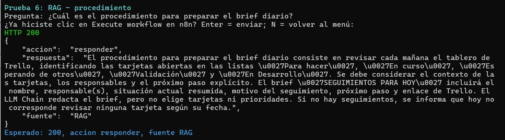
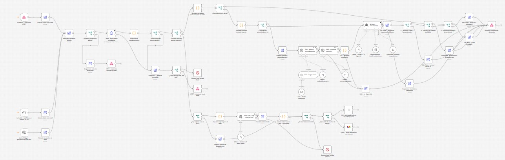

# Evidencias reales de n8n

Las siguientes imágenes proceden de capturas de pantalla **reales** compartidas durante las pruebas. No son recreaciones ni ejecuciones automáticas de GitHub.

## 1. Prueba de RAG — HTTP 200

La captura corresponde a una ejecución del recorrido documental con `fuente: RAG`. La última versión se volvió a probar posteriormente con los mismos campos y HTTP 200; el texto de la respuesta puede variar entre ejecuciones.

## 2. Previsualización del brief — sin correo

Captura real del nodo `FIN - previsualización y envío bloqueado`, con `cobertura_completa: true` y `respaldo_deterministico: true`. **El cuerpo del correo fue ocultado deliberadamente** para proteger nombres, enlaces y detalles internos. No se envió Gmail en esta prueba.

## 3. Vista general del canvas (versión previa)

Captura del workflow **durante el desarrollo**, anterior a la última normalización JSON. **La exportación definitiva de 58 nodos**, en [workflow/asistente-trello-ollama-rag.json](../workflow/asistente-trello-ollama-rag.json), es la referencia estructural final.

## Privacidad y límites

No publicar imágenes que contengan credenciales, claves, datos de personas, descripciones operativas municipales ni enlaces privados de Trello. Las capturas se muestran con alcance y etiquetas explícitas; no implican despliegue a Internet ni reemplazan la ejecución local reproducible.

Para ver salidas resumidas y resultados adicionales: [tests/EVIDENCIAS-SANITIZADAS.md](../tests/EVIDENCIAS-SANITIZADAS.md).
