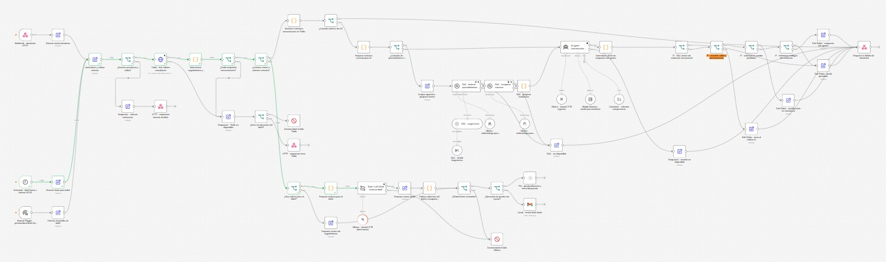
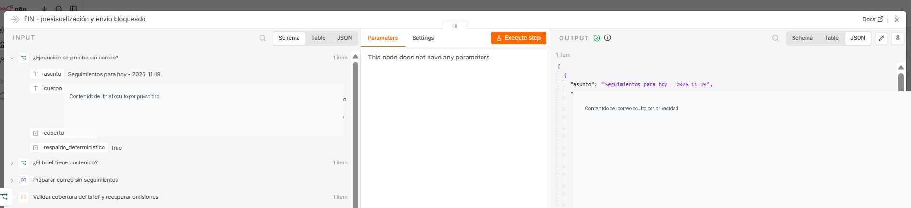

# Evidencias reales de n8n — versión definitiva

Las tres imágenes proceden de capturas **reales de la versión definitiva** compartidas por el autor. No se fabricaron ejecuciones ni resultados. La imagen del brief fue anonimizada antes de publicarla.

## 1. Canvas del workflow definitivo — 58 nodos

Se observan los tres disparadores (Webhook, Schedule y Manual Trigger), el circuito de lectura de Trello, el AI Agent con Ollama y RAG, el normalizador del JSON y la ruta de previsualización del brief. Esta captura **reemplaza la imagen anterior del canvas**, correspondiente a una etapa previa.

## 2. Prueba 6 — RAG con HTTP 200

Pregunta: «¿Cuál es el procedimiento para preparar el brief diario?». Salida real: `accion: responder`, `fuente: RAG`, HTTP 200. La respuesta describe el procedimiento basado en las síntesis académicas del proyecto.

## 3. Brief diario — previsualización sin Gmail

El nodo `FIN - previsualización y envío bloqueado` concluyó correctamente. Sus indicadores fueron `cobertura_completa: true` y `respaldo_deterministico: true`. **Se ocultó el cuerpo del correo** para evitar divulgar personas, tareas y enlaces de Trello. No se envió Gmail.

## Privacidad y alcance

La captura del brief contiene una intervención de anonimización claramente indicada; los estados y los indicadores del nodo son de la ejecución real. La copia del workflow publicada en [workflow/](../workflow/asistente-trello-ollama-rag.json) omite credenciales y sustituye los IDs privados por marcadores.

Las capturas **no implican** que WhatsApp/Meta esté integrado o que n8n esté desplegado en una URL pública. Ver también [resultados de pruebas](../tests/RESULTADOS-REALES.md) y [salidas de consola anonimizadas](../tests/EVIDENCIAS-SANITIZADAS.md).
