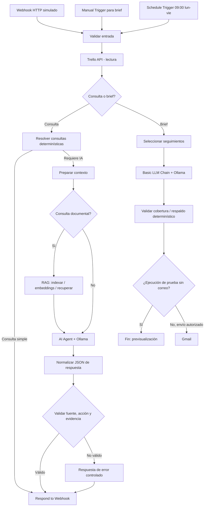

# Arquitectura del workflow definitivo (58 nodos)

Este es un **diagrama funcional esquemático**, realizado a partir de la exportación de n8n. No sustituye una captura de pantalla ni representa cada uno de los 58 nodos.

## Controles del prototipo

- El agente no tiene herramientas para editar Trello. Los cambios se derivan a intervención humana.
- `due` se interpreta como **fecha de seguimiento**, no vencimiento de entrega.
- RAG usa fragmentos de las preentregas académicas y nunca sustituye los datos operativos actuales.
- El normalizador de JSON está aislado en un nodo `Code`; los `IF` posteriores comprueban evidencia y formato.
- El modo manual de brief no envía Gmail.
- El Vector Store es de memoria y se reconstruye durante el recorrido documental.

Para reproducirlo se requieren credenciales locales de Trello, Ollama y Header Auth, y el reemplazo de los IDs privados indicados en [README.md](../README.md).
